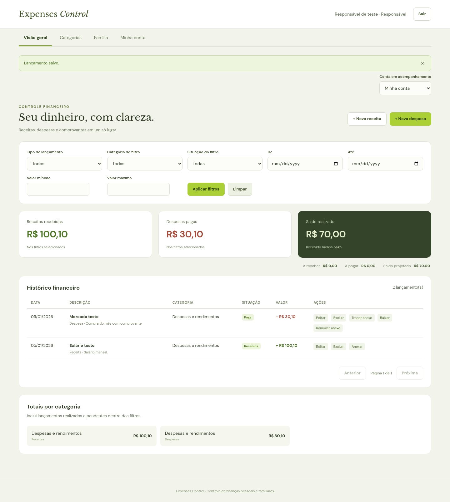
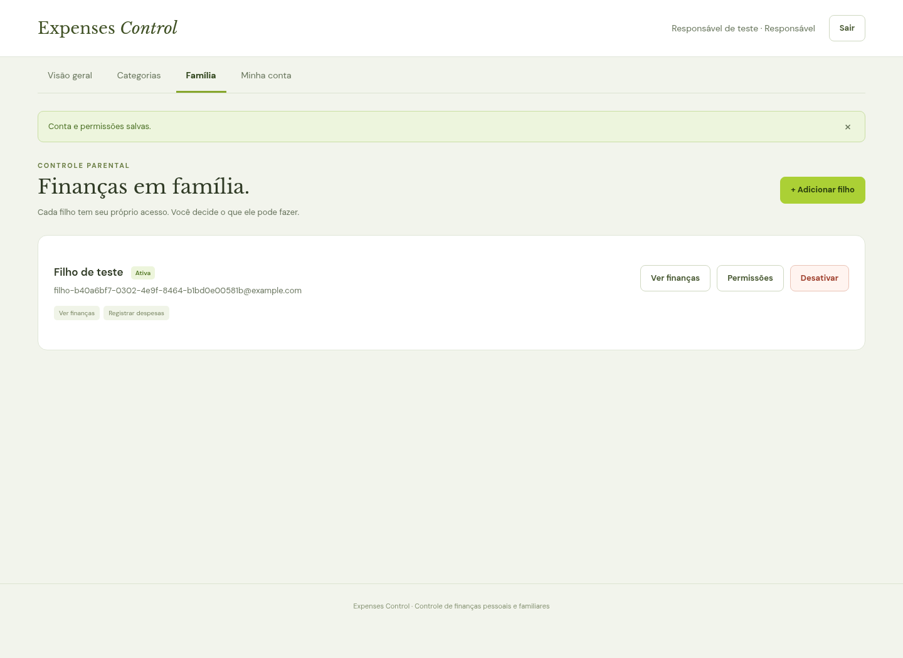

# Expenses Control — Finanças Pessoais Seguro

Sistema web para organizar receitas e despesas, guardar comprovantes e acompanhar as finanças dos filhos com permissões individuais. Frontend React e backend Express reunidos em um único projeto, com MySQL e Sequelize.

**Repositório de entrega:** [Desenvolvimento de Sistema Web de Finanças Pessoais Seguro](https://github.com/gustavojtm609-lgtm/Desenvolvimento-de-Sistema-Web-de-Finan-as-Pessoais-Seguro).

## Funcionalidades

- Cadastro, login, logout e alteração de senha com encerramento das sessões.
- Receitas e despesas com categoria, data, valor, observações e situação.
- Saldo realizado, valores a receber e a pagar e saldo projetado.
- Histórico paginado com filtros por tipo, categoria, situação, datas e valores.
- Um comprovante PDF, JPG, PNG ou WebP por lançamento, de até 5 MB, com envio, substituição, download e remoção.
- Categorias isoladas por conta, com criação, edição e exclusão.
- Responsável cria contas de filhos, escolhe permissões, redefine senhas e desativa acessos.
- Responsável acompanha cada filho pelo seletor de conta; filhos não acessam contas de outras pessoas.
- Interface responsiva em português, com rótulos associados aos campos e navegação por teclado.

O saldo realizado considera apenas receitas **recebidas** menos despesas **pagas**. Lançamentos pendentes afetam o saldo projetado. Os cartões e o histórico usam os mesmos filtros; valores por categoria incluem realizados e pendentes. Valores monetários usam `DECIMAL(12,2)` no MySQL e centavos inteiros (`BigInt`) no cálculo dos saldos.

## Telas





## Tecnologias

| Camada | Tecnologias |
| --- | --- |
| Interface | React 19, Vite 8, React Router, Axios, CSS Modules |
| API | Node.js 24 LTS, Express 5, Sequelize 6, MySQL 8.4 |
| Segurança | bcrypt, Helmet/CSP, Zod, express-rate-limit, cookie-parser, sessões no banco, token CSRF |
| Comprovantes | Multer, file-type, armazenamento BLOB privado no MySQL |
| Verificação | Node Test Runner, Playwright/Chromium, ESLint, npm audit, GitHub Actions |
| Execução | npm workspaces, Docker e Docker Compose v2 |

## Rodar localmente com Docker

Instale **Node.js 24 LTS** (com npm) e **Docker Desktop**, ou Docker Engine com Compose v2. Com Docker iniciado, abra um terminal na raiz do projeto:

```bash
npm run setup
docker compose up --build -d --wait
```

Abra **http://localhost:3000**, clique em **Cadastre-se aqui** e crie sua conta. A senha deve ter pelo menos 10 caracteres, incluindo letra e número. Após entrar, crie uma categoria e registre as receitas e despesas.

`npm run setup` funciona antes de instalar dependências: cria o `.env` na raiz com senhas aleatórias do MySQL. Um `.env` existente é preservado. O container aplica migrations antes de iniciar. Não há conta de administrador com senha fixa e não é necessário executar seeders.

```bash
docker compose logs -f app
docker compose down
```

O banco e os comprovantes ficam no volume `mysql_data`. `docker compose down` preserva os dados. Não exclua esse volume para manter seu histórico. Trocar a senha no `.env` depois da primeira inicialização não altera automaticamente a senha já gravada no MySQL.

## Desenvolvimento com recarregamento automático

Para usar Docker somente para o MySQL:

```bash
npm ci
npm run setup
npm run db:up
npm run db:migrate
npm run dev
```

- Interface: **http://localhost:5173**.
- API e verificação de saúde: **http://localhost:3000/api/health**.
- O Vite encaminha `/api` ao backend. `Ctrl+C` encerra os dois serviços.

Se a aplicação completa já estiver no Docker, execute `docker compose stop app` antes de iniciar o backend local, para liberar a porta 3000.

### Com MySQL já instalado, sem Docker

Execute `npm ci` e `npm run setup`. Edite `MYSQL_HOST`, `MYSQL_PORT`, `MYSQL_DATABASE`, `MYSQL_USER` e `MYSQL_PASSWORD` no `.env` para corresponder ao seu MySQL. Crie o banco indicado ou execute `npm run db:create` com um usuário autorizado a criar bancos. Depois:

```bash
npm run db:migrate
npm run dev
```

### Versão final servida pelo Express

Com dependências, `.env` e MySQL configurados:

```bash
npm run db:migrate
npm run build
npm start
```

Interface e API funcionam em **http://localhost:3000**, incluindo acesso direto a `/login` e `/register`. O diretório `frontend/dist` é gerado por `npm run build` e não é versionado no GitHub.

## Usar o controle parental

1. Entre na conta do responsável e abra **Família → Adicionar filho**.
2. Informe nome, e-mail exclusivo, senha inicial e funções permitidas. O filho entra pela mesma tela de login.
3. Use **Ver finanças** ou **Conta em acompanhamento** para criar categorias e acompanhar os lançamentos do filho.
4. Em **Permissões**, altere o acesso ou redefina a senha. **Desativar** bloqueia o login e revoga as sessões do filho.

| Permissão | O que libera | Padrão do filho |
| --- | --- | --- |
| Ver finanças | Consultar o próprio histórico, categorias e saldo | Sim |
| Registrar receitas | Criar entradas | Não |
| Registrar despesas | Criar saídas | Não |
| Editar e excluir lançamentos | Alterar e apagar lançamentos da própria conta | Não |
| Gerenciar categorias | Criar, editar e excluir categorias da própria conta | Não |
| Enviar e baixar comprovantes | Enviar, substituir, baixar e remover comprovantes próprios | Não |

Sem **Ver finanças**, todos os recursos financeiros ficam bloqueados. O responsável mantém o acesso às contas que criou. As permissões são consultadas no banco em cada requisição, e não apenas usadas para ocultar botões. Um filho não cria subcontas, não altera seu vínculo e não aumenta suas permissões. O controle se aplica às contas vinculadas à família.

## Proteções de segurança implementadas

| Requisito | Implementação e evidência |
| --- | --- |
| Hardcoded SQL / SQL Injection | Consultas de execução e seeders usam Sequelize. Filtros e identificadores são validados; valores nunca são concatenados em SQL. Agregações usam colunas fixas. Testes enviam operadores e payloads de SQL e verificam rejeição. |
| XSS | React renderiza os textos como dados, sem `dangerouslySetInnerHTML`. Helmet aplica CSP com scripts e estilos da própria origem, sem `unsafe-inline` ou `unsafe-eval`, além de `nosniff` e bloqueio de frames. O teste de navegador insere uma tag com `onerror` e verifica que ela não executa. |
| CSRF | Sessão em cookie `SameSite=Strict`, token sincronizador por sessão enviado em `X-CSRF-Token`, comparação segura e lista explícita de origens. Operações de escrita exigem origem válida. Login/cadastro aceitam JSON e verificam origem. Token ausente, inválido e origem maliciosa são testados. |
| Mass Assignment | Schemas Zod `.strict()` rejeitam campos desconhecidos. Controllers atribuem campos permitidos explicitamente. `userId`, `parentId`, `role` e permissões não são aceitos nos formulários financeiros ou no cadastro público. |
| Session Hijacking | Cookie `HttpOnly`, `SameSite=Strict` e opção `Secure` para HTTPS. Identificador aleatório de 256 bits, renovado no login e armazenado somente como hash SHA-256 no banco. Sem token no `localStorage`. Expiração absoluta, limite de inatividade e revogação no logout, troca/redefinição de senha e desativação do filho. |
| Autenticação segura | Hash bcrypt com custo 12, senha com letra/número e limites de tamanho, mensagem genérica no login e limite de tentativas. A senha nunca aparece na resposta. |
| Autorização / IDOR | Cada consulta financeira exige a conta autorizada. Responsável só acompanha filhos vinculados a ele. Categorias, lançamentos e comprovantes de outras contas não podem ser acessados por troca de ID. |
| Validação de entrada | Limites para textos, JSON de até 32 KB, UUIDs, datas de 1900 a 2100, valores positivos com até duas casas decimais, enums e paginação de até 100 registros. Campos extras são rejeitados. |
| Upload de arquivos | Até 5 MB e um arquivo por lançamento; extensão, MIME e assinatura binária devem corresponder a PDF/PNG/JPEG/WebP. SVG e HTML são rejeitados. Download autenticado como `attachment`, sem URL pública, sem cache e sem execução de conteúdo. |
| Outras medidas | Limites de requisições, mensagens sem stack/SQL/credenciais, CORS restrito, respostas privadas sem cache e segredos fora do versionamento. |

Consulte [docs/SEGURANCA.md](docs/SEGURANCA.md) para configuração, limites e roteiro de demonstração. Nenhuma senha real, cookie ou token deve ser incluído no Git ou enviado pelo chat.

### Configuração de sessão e publicação com HTTPS

No desenvolvimento HTTP, mantenha `SESSION_COOKIE_SECURE=false`. Ao publicar com HTTPS, configure:

```dotenv
APP_ORIGIN=https://seu-dominio.example
DEV_ORIGIN=https://seu-dominio.example
SESSION_COOKIE_SECURE=true
```

Se houver exatamente um proxy reverso confiável, configure `TRUST_PROXY=1`; caso contrário, mantenha `0`. A aplicação não configura domínio, certificado TLS ou hospedagem automaticamente.

| Variável | Uso |
| --- | --- |
| `PORT` | Porta do Express e porta publicada no host, padrão 3000 |
| `APP_ORIGIN` | Origem exata da interface final, padrão `http://localhost:3000` |
| `DEV_ORIGIN` | Origem exata do Vite, padrão `http://localhost:5173` |
| `MYSQL_*` | Banco e credenciais; o Compose usa `db:3306` dentro da rede Docker |
| `SESSION_COOKIE_SECURE` | Cookie apenas via HTTPS quando `true` |
| `SESSION_HOURS` | Expiração absoluta da sessão, padrão 8 horas |
| `SESSION_IDLE_MINUTES` | Expiração por inatividade, padrão 30 minutos |
| `TRUST_PROXY` | Confiança em um único proxy reverso, padrão `0` |
| `VITE_API_URL` | Deixe vazio para `/api` na mesma origem |
| `DEMO_PASSWORD` | Opcional, somente para criar conta de demonstração com seeders |

Se alterar a porta externa, ajuste também `APP_ORIGIN`. Origens não usam caminho nem barra final. A forma recomendada é interface e API na mesma origem; cookies `Strict` não se destinam a uma interface hospedada em outro site.

## Testes e verificações

Com o MySQL configurado, use preferencialmente um banco exclusivo para testes:

```bash
npm run db:migrate
npm run lint
npm run build
npm test
npm audit --omit=dev
```

`npm test` executa a suíte de integração HTTP com MySQL real. Cria dados exclusivos e os remove ao terminar. Abrange saldo, filtros, anexos, família, isolamento, CSRF, mass assignment, SQL Injection, sessão, força bruta e cabeçalhos de segurança.

Para testar a interface, deixe `npm start` rodando em outro terminal e execute:

```bash
npx playwright install chromium
npm run test:e2e
```

O teste de navegador cobre cadastro/login, receitas, despesas, saldo, anexo, filtros, edição, conta de filho, bloqueios, desativação, troca de senha, logout, XSS e tela móvel. Por padrão usa `http://localhost:3000`. `BASE_URL` pode alterar esse destino; `CHROMIUM_EXECUTABLE_PATH` permite usar um Chromium instalado. `SCREENSHOT_DIR` habilita capturas opcionais. A origem configurada na API deve corresponder ao endereço utilizado.

O workflow [.github/workflows/ci.yml](.github/workflows/ci.yml) instala dependências, inicia MySQL, aplica migrations, executa lint, build, testes e auditoria a cada push ou Pull Request.

## Estrutura

```text
backend/src/
  config/           # Ambiente, banco e opções de segurança
  models/           # Usuário, sessão, categoria, lançamento e comprovante
  controllers/      # Autenticação, família, finanças e comprovantes
  middleware/       # Sessão, autorização, CSRF, origem, limites e validação
  routes/           # Endpoints organizados por recurso
  lib/              # Schemas e erros HTTP
  database/         # Migrations e seeders opcionais
frontend/src/
  contexts/         # Sessão carregada do servidor
  services/         # Cliente HTTP e token CSRF em memória
  pages/            # Login, cadastro e painel financeiro/familiar
  styles/           # Tema e fontes locais
scripts/            # Preparação do .env
tests/              # Integração e navegador
docs/               # Segurança, API, equipe e origem
.github/            # CI e modelo de Pull Request
```

A tabela original `expenses` agora representa receitas e despesas, diferenciadas por `type`. As migrations preservam os registros existentes como despesas e acrescentam as estruturas de família, sessões e comprovantes. A autenticação JWT anterior foi substituída: faça login novamente após atualizar. Os endpoints atuais estão em [docs/API.md](docs/API.md).

### Dados de demonstração opcionais

Você pode cadastrar uma conta pela interface sem usar seeders. Para demonstração local, defina uma senha forte exclusiva em `DEMO_PASSWORD` no `.env` e execute `npm run db:seed` (ou `docker compose exec app npm run db:seed`). O e-mail será `admin@expensescontrol.com`; a senha não é fixa nem versionada. Não reutilize uma senha pessoal. Os seeders são registrados no banco e podem ser repetidos sem duplicação.

## Trabalho em equipe e entrega

Use branches para tarefas e Pull Requests revisados antes do merge. Há uma divisão sugerida de atividades em [docs/EQUIPE.md](docs/EQUIPE.md), um modelo de PR e uma lista de demonstração de segurança. Preencha os nomes reais dos integrantes e registre as contribuições efetivas nos commits e PRs.

O código precisa estar no repositório indicado e acessível ao professor; se o repositório for privado, conceda o acesso pelo GitHub. O README contém a descrição, tecnologias, instalação e tratamento das vulnerabilidades exigidas.

## Origem dos trabalhos integrados

A base foi composta a partir do frontend de Gabriel Müehlbauer em [ExpensesControl](https://github.com/GabrielMuehlbauer/ExpensesControl), commit `a6f182f7da52d8a5b7eb82828f18ca4f78f43825`, e da API em [expenses-control-api](https://github.com/GabrielMuehlbauer/expenses-control-api), commit `07b0774fd1ed574c801bbd41103341b1134c4954`. A identidade visual e os recursos de categorias/despesas foram usados como base para esta evolução. Consulte os históricos e os arquivos de licença dos projetos de origem antes de redistribuir sob outra licença.
